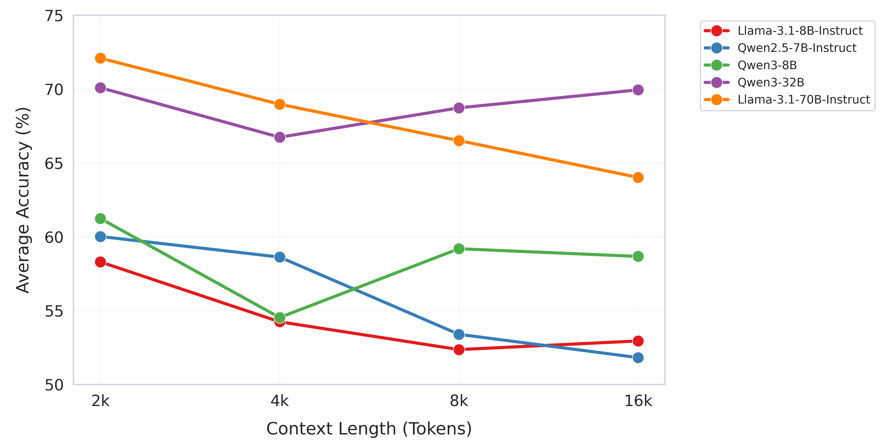

# Context Shapes LLMs Retrieval-Augmented Fact-Checking Effectiveness

Code, prompt templates, filler input, and figures for the paper by Pietro Bernardelle, Stefano Civelli, Kevin Roitero, and Gianluca Demartini.

**Status: private release candidate.** CPU regression tests and execution commands are provided. Full GPU reruns and reconciliation of the manuscript results are pending. Read the [reproducibility notes](docs/reproducibility.md) before using this as an exact reproduction of the paper.

## Installation

Use Python 3.11 in an isolated environment:

```bash
python3.11 -m venv .venv
source .venv/bin/activate
python -m pip install -r requirements-analysis-lock.txt
python -m unittest discover -s tests -v
```

`requirements.txt` pins direct analysis dependencies. `requirements-analysis-lock.txt` records all packages in the tested Python 3.11 analysis environment. It was tested on macOS arm64 and is not a recovered historical environment.

For GPU inference, create a separate Python 3.11 environment on Linux with NVIDIA GPUs:

```bash
python -m pip install -r requirements-inference.txt
```

This pins vLLM 0.8.5.post1, observed in experiment logs, and its required PyTorch 2.6.0. Follow the [versioned vLLM installation instructions](https://docs.vllm.ai/en/v0.8.5/getting_started/installation/gpu.html) for compatible drivers and CUDA binaries. GPU inference has not been revalidated for this release. Allocate sufficient GPU memory and set `--tensor-parallel-size` to the allocated GPU count. Authenticate separately with Hugging Face for gated model access.

## Data availability

Prepared datasets are not redistributed because redistribution permissions have not been confirmed. Users must obtain source datasets separately under their applicable terms. This describes this release; it does not claim the original datasets prohibit redistribution.

Dataset and generated-output directories contain empty placeholders. The original [filler passage](data/raw/filler/README.md) is included with separate attribution and licensing. No dataset rows, instantiated prompts, predictions, metrics CSVs, logs, or weights are included. [Data documentation](docs/data.md) describes input schemas, sources, and reconstruction limitations.

## Configuration

Scripts default to `config/paper_config.json`:

- Models: Llama-3.1-8B-Instruct, Qwen2.5-7B-Instruct, Qwen3-8B, Qwen3-32B, Llama-3.1-70B-Instruct.
- Context lengths: 2,048, 4,096, 8,192, and 16,384 tokens.
- Evidence positions: 0% through 100% in steps of 10%.
- Sampling seed: 42. Inference seed: 22. Temperature: 0. Maximum generated tokens: 16.
- Labels: **0 = SUPPORTS, 1 = REFUTES**.

`config/prompt_config.json` retains the original broader settings for provenance. Original model revision hashes were not recovered. Optional `revision` values in each model's configuration are passed to model and tokenizer loading when supplied.

## Prepare inputs and prompts

The [prompt templates](prompts/README.md) provide the exact system instructions,
claim-only template, and claim-with-context template as readable text files.
Scripts read the matching strings from `config/paper_config.json`.

Run from the repository root after supplying the local inputs described in [docs/data.md](docs/data.md):

```bash
python src/scripts/0_preprocessing.py --steps raw standardize combine
python utils/add_hover_split.py
python src/scripts/6_build_experiment_subset.py --seed 42 --feverous-per-label 2000
python src/scripts/2_prompts_no_filler.py --config config/paper_config.json

for model in Llama-3.1-8B-Instruct Qwen2.5-7B-Instruct Qwen3-8B Qwen3-32B Llama-3.1-70B-Instruct; do
  python src/scripts/3_prompts_with_filler.py --config config/paper_config.json --model "$model"
done
```

## Run inference

Inside a GPU allocation, select a model and GPU count. Repeat for each model:

```bash
MODEL=Qwen3-8B
TP=1
python src/scripts/4_inference_vllm.py --config config/paper_config.json --models "$MODEL" \
  --prompts-dir out/prompts/no_filler/claim_only --tensor-parallel-size "$TP"
python src/scripts/4_inference_vllm.py --config config/paper_config.json --models "$MODEL" \
  --prompts-dir out/prompts/no_filler/multi --tensor-parallel-size "$TP"
python src/scripts/4_inference_vllm_subset_bunya.py --config config/paper_config.json --models "$MODEL" \
  --prompts-dir 'out/prompts/with_filler/{model}/multi' --tensor-parallel-size "$TP"
```

Subset inference checks existing outputs before skipping them. An incomplete file requires an explicit `--overwrite` rerun; missing rows are not automatically resumed.

## Validate and analyze

Audit all 230 expected files: two baselines and 44 filler conditions per model.

```bash
python src/scripts/audit_results.py
```

The audit fails if files, rows, labels, or valid predictions are missing or inconsistent. It checks duplicate multiplicities and dataset/claim identities. Resolve findings before treating new plots as complete evaluations.

```bash
mkdir -p out/tables
python src/scripts/5_results_analysis.py
python src/scripts/10_generate_latex_table.py > out/tables/paper_tables.tex
python src/scripts/9_context_length_analysis.py --only-avg
python src/scripts/7_filler_positioning_analysis.py --ticks-01-spaced --combined-only
```

New figures go to ignored `out/figures/`; tables go to ignored `out/tables/`. The table generator accepts `--results-dir`, `--filler-results-dir`, `--subset-file`, and `--config`. Historical Figure 1 averaging can be inspected with `9_context_length_analysis.py --only-avg --all-positions`, which includes additional evidence positions if present.

## Original paper figures

Both PNGs match every RGB pixel of the corresponding images embedded in the supplied manuscript. They have not been replaced by outputs from corrected analysis code.




[Figure 2 PDF](images/spaced_by_0.1/combined_accuracy_5models.pdf).

## Citation and license

See [CITATION.cff](CITATION.cff) and the [MIT license](LICENSE) for code and prompt templates. The Wikipedia-derived filler is separately licensed under [CC BY-SA 4.0](data/raw/filler/README.md). Dataset and model terms remain separate. No DOI or final publication identifier is claimed yet. [Release instructions](docs/release.md) describe the remaining steps toward a public, citable version.

The original snapshot is commit `1e149ae04f7b7bff2dc45c2d2ebfda5e78e69f8d`. [CHANGELOG.md](CHANGELOG.md) identifies subsequent corrections.
